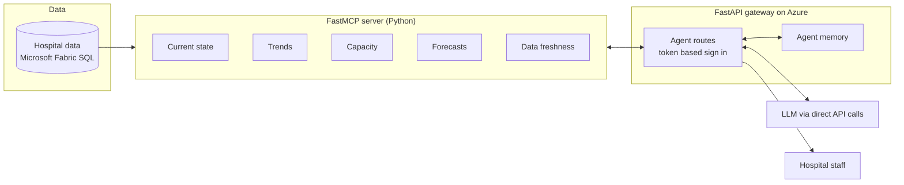
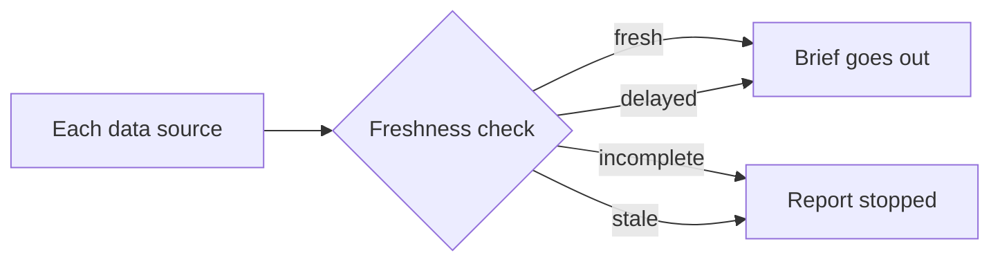

# Care Advisor: case study

Care Advisor is a patient flow and capacity assistant I build at Cincinnati Children's Hospital Medical Center as an AI/ML and Data Engineering intern (May 2026 to present). Hospital staff ask it questions about census, capacity, and forecasts, and it answers from live hospital data.

This repo is a write up of how it works and what I learned. The code and data belong to the hospital, so neither is published here.

## The rule it is built on

**Python does the math. The model only explains it.**

A language model should never be the thing that adds up beds or computes a forecast. Every number Care Advisor reports comes from a typed tool written in Python. The model's job is to pick the right tool, call it with valid inputs, and explain the result in plain language.

## Architecture

## What I built

**Eleven typed data tools.** A FastMCP Python server exposes eleven tools for current state, trends, capacity, forecasts, and data freshness. Each tool runs its own SQL and returns computed results.

**Flat tool schemas.** The first version took nested query objects as input, and the model kept producing malformed calls. I rewrote every tool with a flat, typed Pydantic signature. Tool calls became reliable, and every input is validated before it touches the database.

**A gateway in a private network.** A FastAPI gateway runs in Docker on Azure inside a private network, with token based sign in. The CI pipeline runs ruff, mypy, tests, and the image build on every change. I am building routes that list, describe, and run agents behind the gateway. I also integrated an agent memory service so the agent can recall earlier context.

**A daily capacity brief.** A scheduled Microsoft Fabric pipeline calls the gateway every day. A single turn prompt turns tool output into a short narrative, and the brief posts to a Teams channel for hospital staff, with run status logged for every run.

## The freshness gate

Before the brief is written, a freshness check classifies every source as fresh, delayed, incomplete, or stale. If the data isn't ready, the report stops. Sending nothing is better than sending staff a confident wrong number.

## Finding problems that throw no errors

A data quality audit turned up three production bugs. The one I learned the most from was a filter comparing NULL to text, which returned empty results with no error. Nothing looked broken, but the answers were wrong.

After that I added structured logging before every path that could fail silently. I also built evaluation test sets and scoring for Care Advisor answers, and added Langfuse tracing so every agent run can be reviewed.

I also reviewed the SARIMAX forecasting library behind the forecast tools, using MLflow. Near term forecasts were not updating with fresh data, so I raised it with the team.

## What I would tell someone building something similar

1. Keep the arithmetic in code you can test. Let the model explain, not compute.
2. Flatten tool inputs. Models handle simple typed arguments far better than nested objects.
3. Put a data check in front of anything automated. Stale data is the most common way a report goes wrong.
4. Log before every silent failure path. The worst bugs return empty results, not errors.
5. Document every tool's SQL and plain language logic, so analysts can check the numbers without reading code.

## Stack

Python, FastMCP, Pydantic, FastAPI, Docker, Azure, GitHub Actions (ruff, mypy, pytest), Microsoft Fabric, Teams, Langfuse, MLflow

## Contact

Sumit Kashid · [sumit-kashid.github.io](https://sumit-kashid.github.io) · [LinkedIn](https://www.linkedin.com/in/sumit-kashid/) · sumitkashid505@gmail.com
